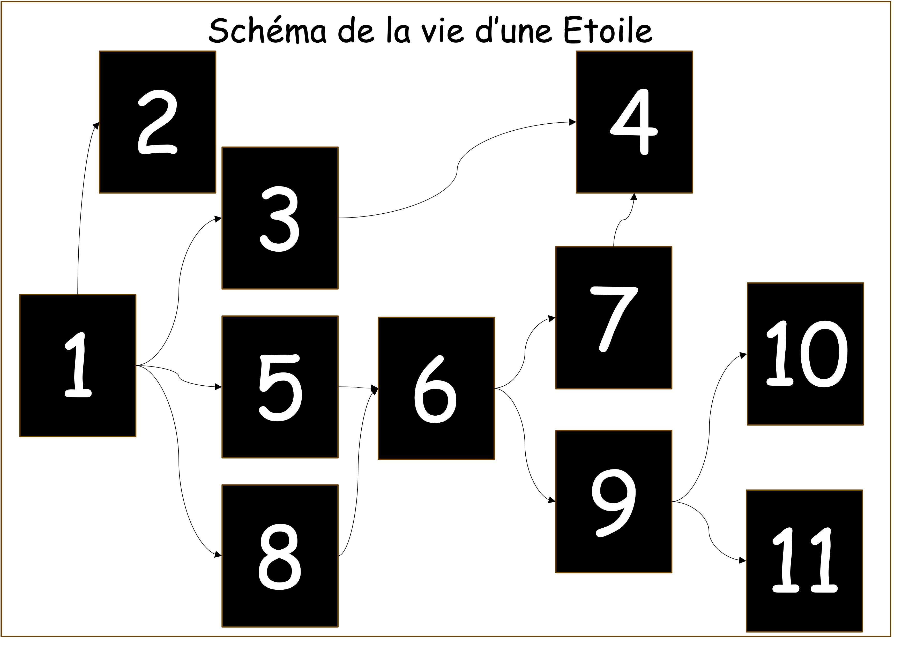

# **Plan détaillé**

## **Cours magistral** 
### **Introduction (5 minutes)**
L'introduction comprend l'installation des élèves est une présentation succincte de la séance et des intervenants. (Slide 1 à 3)

### **Du quotidien à l’espace (10 minutes)**
- Dézoom progressif (diapositives projetées) : de l’école à la Terre, puis au système solaire puis zoom sur le Soleil.(1 minute)
- // Questionnement : Qu’est-ce que le Soleil ? Pourquoi semble-t-il plus gros et lumineux que les autres étoiles ? ( 1 minute)
- // Réponse : Parce que les autres étoiles sont beaucoup plus loin de la Terre que ne l’est le Soleil. Conséquence : l’univers est immense . (2 minutes)
- Explication succincte de ce qu’est une étoile : une étoile est une énorme boule de gaz/feu très chaude qui produit de la lumière. (3 minutes)

La présentation continu sur un dézoom progressif depuis leur école (à adapter), jusqu'à la Terre et aux système solaire pour ensuite revenir vers le Soleil. (Slide 4 à 11)
<u>Questionnement </u>: Qu’est-ce que le Soleil ? Pourquoi semble-t-il plus gros et lumineux que les autres étoiles ? 
Nous expliquerons ensuite de manière rapide ce qu’est une étoile en parlant aussi des différentes couches qui composent le Soleil. (slide 12)

### **La vie des étoiles (35 minutes)**
- Formation à partir de nuages de gaz qui s’effondrent sur eux-mêmes. (5 minutes)
- Équilibre entre l’effondrement et la pression interne. (5 minutes)
	- La notion de gravité doit être expliquée (Slide 15 à 16)

- Reprise de l’effondrement lorsqu’il n’y a plus assez d’hydrogène à consommer. Puis différents devenirs possibles selon la masse de l’étoile : naine blanche, géante rouge, supernova, étoile à neutrons et trou noir. (15 minutes)

## **Expérience : Simulation informatique (30 minutes)**
La simulation est divisée en deux partie. Dans un premier temps, les élèves observeront la formation puis l'évolution d'étoiles au sein d'une répartition initiale de masse. Puis dans un second temps, il rajouteront eux même des nuages de gaz durant la simulation afin de créer les différents types d'étoiles vus pendant la présentation.

### **Organisation :**
Les élèves disposeront d'un ordinateur pour deux sur lequel la simulation sera ouverte. Les intervenants circuleront tout au long l’activité afin de veiller à son bon déroulement.

### **Déroulement de l’activité :**

Nous commencerons par présenter la simulation et expliquer les consignes de la première partie : `Consignes`. (Slide 39 à 40).
Une correction de la première partie sera ensuite proposée (total 10min). 

Nous passerons à la seconde partie en explicitant les consignes : `consignes` (slides 41 à 42) (total 20min). Des indices peuvent être proposés au cours de cette partie pour aider les élèves (Slide 43).

Pour plus d'informations sur la simulation, voir la rubrique «[Simulation Informatique](simulation.md)»
 
## **Activité 2 : Fresque (30 minutes)**

Les intervenants présentent aux élèves la fresque ci-dessus et [les cartes](assets/ressource/cartes_frises.pdf) correspondant aux différents objets célestes vus précédemment. Ces derniers doivent placer ces cartes dans les bonnes cases. Les élèves restent à leur place à lèvent la main quand ils ont une idée. Quand un élève est interrogé, les intervenants l'écouteront puis lui demanderont d'expliquer les raisons de sa proposition. (Slide 44 à 56)

### **Déroulement :** 
- Rangement des ordinateurs et explication des consignes (5 min).
- Placement de cartes représentant des objets célestes sur une fresque suspendue au tableau (25 min).

## **Trace écrite, texte à trous (10 minutes)**
- Distribution de la trace écrite (1 min).
- Collage de la trace écrite dans le cahier de science (4 min).
