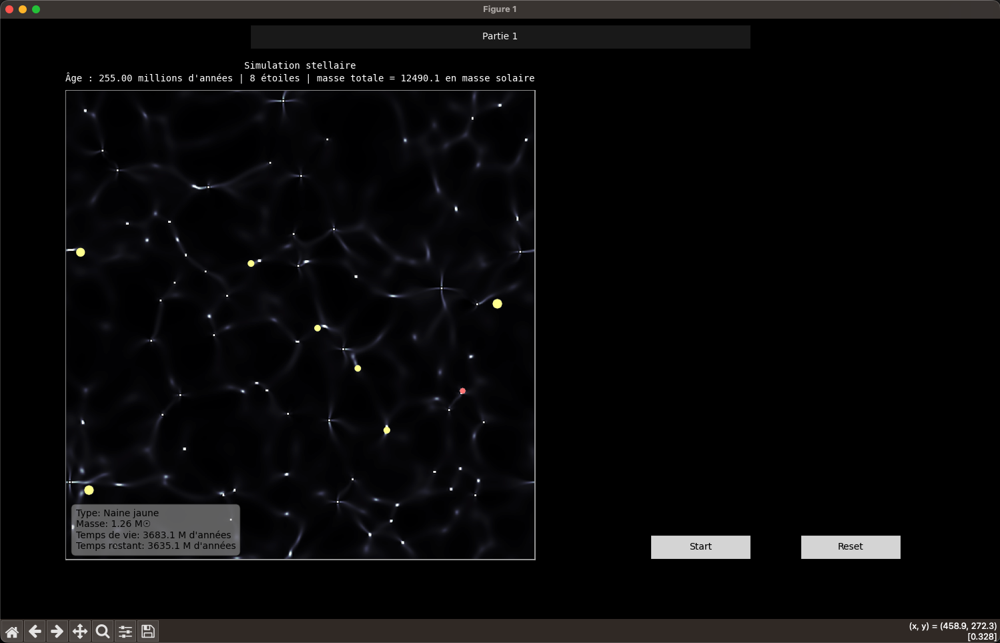

# **Simulation informatique**

Vous trouverez ci-dessous le descriptif de notre simulation. Il est recommandé de suivre avec le ***[code Python](assets/ressource/simulation_final_version.py)***.

 

---
## **Description du code**

**Bibliothèques Python nécessaires :** 

- `numpy`
- `matplotlib` (incluant `pyplot`, `animation`, `patches` et `widgets`)

Les constantes globales définissent : l'échelle de temps (un pas équivaut à un million d'années), le rapport des rayons des différents astres et la masse de ces astres (en masse solaire). 

Nous avons essayé de proposer des valeurs de temps et de masses cohérentes avec la théorie. Néanmoins, les distances et notamment les rayons sont incohérentes permettant une meilleure visibilité des différents astres.

 
### **Classe `Star`** (*lignes 31 à 62*)

Chaque étoile est caractérisée par :  

- Sa **position** dans la grille,
- Sa **masse** initiale et actuelle,
- Son **rayon** et son **temps de vie**, calculés à partir de relations astrophysiques simplifiées.
- Son **type**, déterminé à la naissance selon des seuils de masse :
    _Naine rouge_ (masse faible), _Naine jaune_ (masse intermédiaire), _Géante bleue_ (masse élevée)

L'étoile peut ensuite suivre un des cycles de vie suivant :   
- Une naine jaune devient une géante rouge, puis une **naine blanche**.
- Une géante bleue devient une super géante rouge, puis explose en supernova, laissant derrière elle une étoile à neutrons ou un trou noir selon sa masse.
- Une naine rouge finit directement en naine blanche.

Ainsi seul les astres suivants sont proposés par la simulation : naine rouge, naine jaune, géante bleu, naine blanche, géante rouge, super géante rouge, étoile à neutrons et trou noir (comprenant aussi les supernovas). 

  

#### **Fonctions disponibles**

Pour notre simulation, nous avons codé les fonctions suivantes :   

- `redistribute_envelope` (*ligne 65*): Redistribue la masse éjectée lors d'une supernova ou de la phase de géante rouge (simule l'expulsion de matières).
- `evolve_star_and_get_shed_mass` (*ligne 83*): Gère l'évolution de l'étoile, notamment les différentes étapes de son évolution selon sont temps de vie `timer` et sa masse initiale.
- `merge_stars` (*ligne 158*): Fusionne deux étoiles trop proches en une seule, en conservant la masse totale. 
- `laplacian` (*ligne 218*): Calcule le laplacien de la distribution de masse (diffusion).
- `compute_gravitational_potential` (*ligne 222*): Calcule le potentiel gravitationnel à partir de la distribution de masse via une transformée de Fourier.
- `star_occupancy_mask` (*ligne 235*): Délimite les zones occupées par des étoiles. Utilisée pour empêcher la formation d'étoiles trop proches les une des autres.
- `find_connected_regions` (*ligne 256*): Détecte les zones denses où une étoile peut se former. 
- `evolve_mass_distribution` (*ligne 285*): Gère l'évolution de l'ensemble de la simulation en calculant et retournant la distribution de masse de l'instant suivant. Utilise pour cela toutes les fonctions précédentes.

  
### **Présentation de l'Interface**

#### **Première Partie de la Simulation**

Dans la première partie de la simulation, l'objectif est que les élèves puissent observer l'évolution d'une distribution de masse aléatoire formant différents types d'étoiles et devrons répondre à différentes questions. 

Ils disposerons de 3 boutons : un bouton «Reset» qui relance la simulation, un bouton «Start/Pause» qui met lance ou met en pause la simulation et d'un dernier bouton «Partie 1» (caché tout en haut) permettent de passer d'une partie à l'autre. 

Lorsque le souris passe sur une étoile, des informations sur l'étoile telles que son type, sa masse, son temps de vie total et restant apparaitrons en bas à gauche dans une infobulle.

  

#### **Seconde Partie de la Simulation**

Dans la seconde partie, ils auront la possibilité d'ajouter de la masse en cliquant dans la simulation dans l'optique de former les différentes étoiles listées dans le tableau sur la droite. Le tableau s'actualise automatiquement pendant l'évolution de la simulation pour indiquer si une étoile a été découverte, leur nom, leur couleur, leur nombre et leur temps de vie (nous avons décider d'afficher uniquement le temps de vie de la première étoile découverte de chaque type).  

Les 2 curseurs permettent de contrôler la masse ajouté en ajustant la masse maximale des points dans la zone ou le rayon de la zone.  

Ils disposent toujours des 3 boutons de la partie 1 et des infobulles. 

  
### **Classe `simulation`** (*lignes 380 à 784*)

La simulation s'appuie sur `matplotlib` pour offrir une interface graphique interactive.
L'affichage principale est réalisé avec une carte en nuances de gris et les étoiles sont représentées par des disques colorés selon leur type. 

#### **Fonctionnalités disponibles**

**Boutons (*lignes 440 à 456*):**

- `toggle_pause` (*ligne 587*): Bouton «Start / Pause».
- `reset_simulation` (*ligne 593*): Bouton «Reset». Dans la 1ère partie, le bouton réinitialise la distribution de masse initiale avec une distribution aléatoire et la seconde, il remet à zéro.
- `change_part` (*ligne 628*): Bouton «Partie 1 / Partie 2». 

**Sliders (*lignes 421 à 437*)**
  

**Affichages (*lignes 459 à 537*):**

- `update_info_table` (*ligne 539*): Met à jour le tableau récapitulatif de la seconde partie.
- `on_click` (*ligne 652*): Gère l'ajout de masse lors d'un clique uniquement pour la seconde partie. 
- `info_hover` (*ligne 674*): Gère l'affichage de l'infobulle. 
- `update` (*ligne 696*): Gère l'évolution de l'ensemble de l'interface.

`animate` (*ligne 779*): Lance l'animation. 

  

### **Initialisation** (*ligne 787*)

Nous initialisons la simulation avec un tableau de taille 500x500 de valeurs aléatoires. 